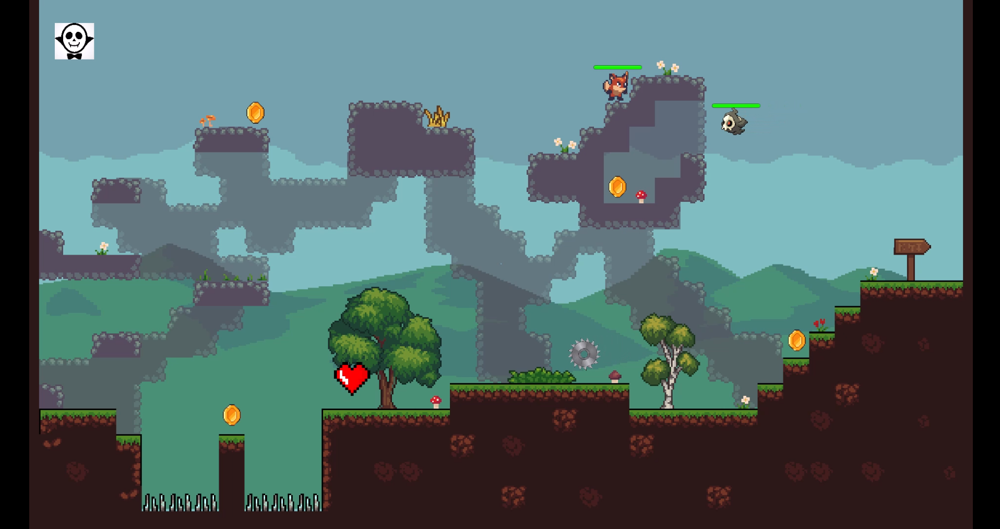
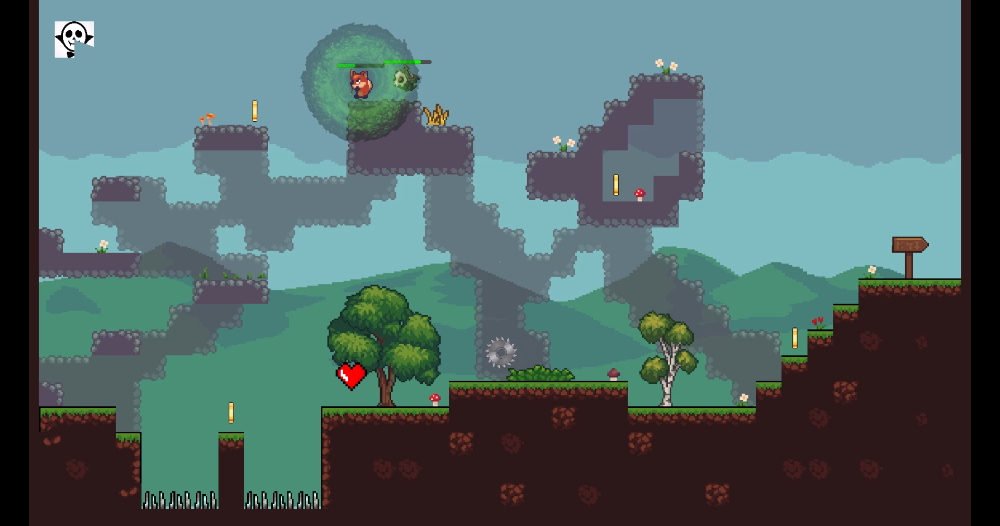
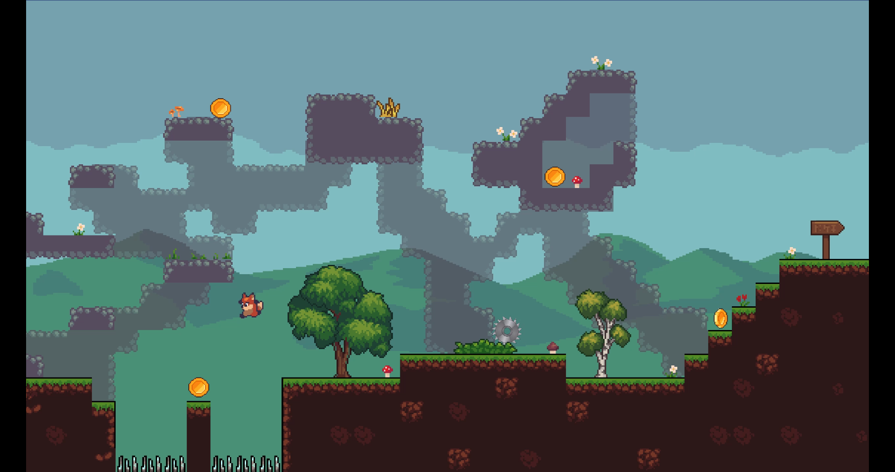

# ForestJorney

**ForestJorney** — учебный 2D-платформер, разработанный на Unity с использованием C#.

Главный герой — белочка, которая исследует игровой уровень, собирает монеты и восстанавливает здоровье с помощью специальных предметов. На пути встречаются противники, патрулирующие территорию и преследующие игрока при обнаружении.

Особенность игры — способность вампиризма, позволяющая отнимать здоровье у ближайшего противника и восстанавливать собственное.

## Реализованные механики

### Игрок
- Передвижение и прыжки с использованием Rigidbody2D.
- Проверка нахождения персонажа на земле.
- Управление через отдельный компонент InputReader.
- Переключение анимаций движения, прыжка и получения урона.

### Противники
- Патрулирование между заданными точками.
- Обнаружение и преследование игрока.
- Возвращение к патрулированию после потери цели.
- Нанесение периодического урона при контакте с игроком.
- Система здоровья и обработка смерти.

### Боевая система
- Атака бейсбольной битой.
- Нанесение урона противникам через Collider2D.
- Способность вампиризма с ограниченным временем действия и перезарядкой.
- Автоматический выбор ближайшего противника в области действия способности.
- Восстановление здоровья игрока при использовании вампиризма.

### Предметы и интерфейс
- Сбор монет и лечебных предметов.
- Система повторного появления предметов.
- Полоска здоровья с плавным обновлением.
- Визуальный индикатор времени действия способности.

## Технические особенности

- Объектно-ориентированное программирование (ООП).
- Наследование, абстрактные и обобщённые классы C#.
- События и делегаты Action для взаимодействия компонентов.
- Корутины для реализации временных игровых механик.
- Разделение игровой логики между специализированными компонентами.
- Работа с Unity Physics 2D, Animator и UI.

## Технологии

- Unity
- C#
- Git / GitHub

## Автор

AndreyOborskij

Учебный проект для практики разработки игровых механик и применения принципов ООП в Unity.

## Скриншоты игрового процесса

### Игровой уровень

### Способность вампиризма

### Передвижение персонажа

## Демонстрация игрового процесса

[▶ Посмотреть игровой процесс и способность вампиризма](Recordings/Movie_017.mp4)

[▶ Дополнительная демонстрация](Recordings/Movie_008.mp4)
